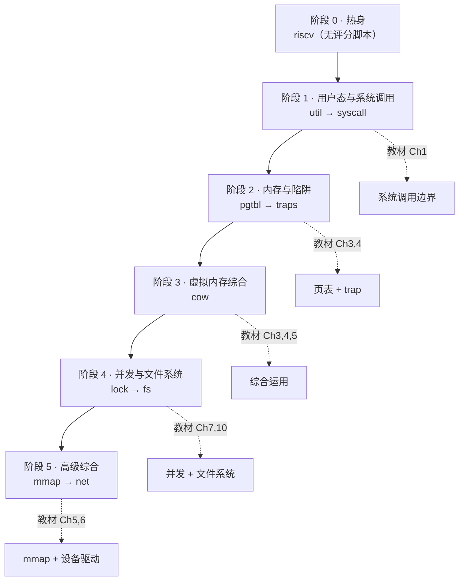
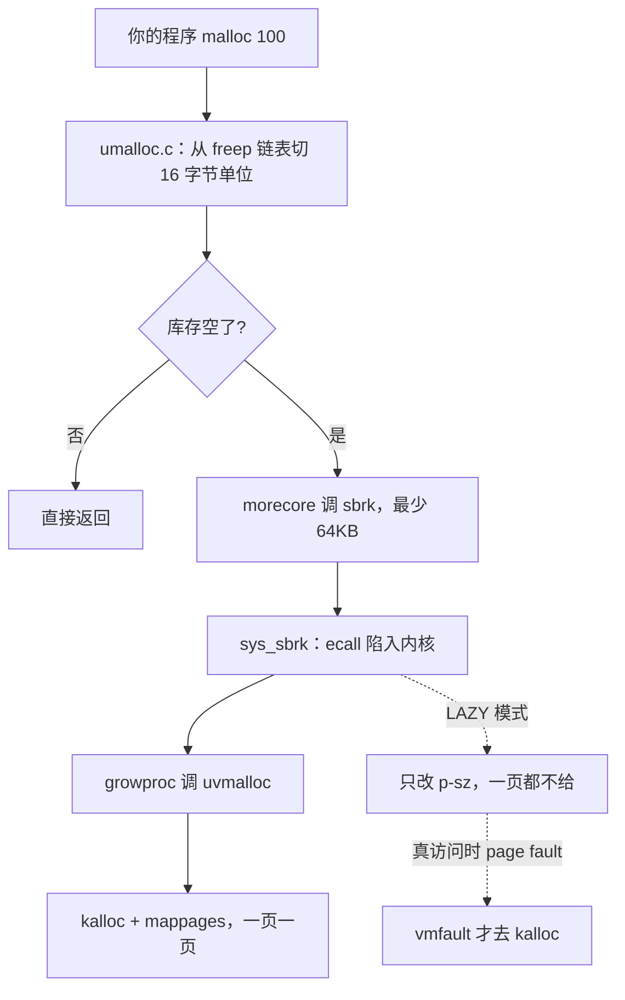
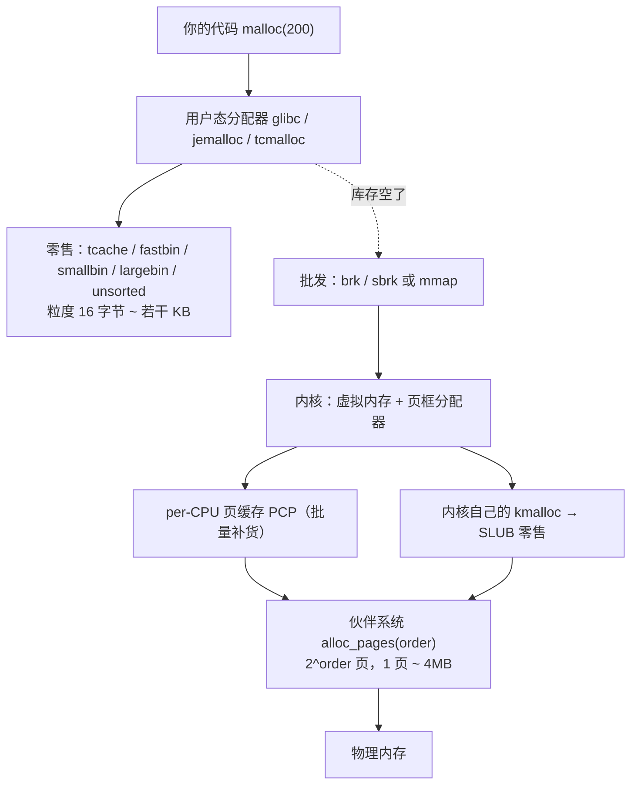

# MIT 6.1810 学习路径 · 进度看板

> 环境已就绪（见 `README.md`）。本文件是**进度看板**：做完一项就勾一项。
> 数据来源：本地 `xv6-labs-2025` 仓库的真实分支与评分脚本（`conf/lab.mk` + `grade-lab-*`）。

---

## 0. 起点

- [x] 环境搭建完成：RISC-V GCC 14.2.0 (xPack) + QEMU 11.1.2 + pexpect venv
- [x] xv6 源码就位（`xv6-labs-2025`，当前 `util` 分支 = Lab 1）
- [x] 教材 PDF 已下载（`docs/book-riscv-rev5.pdf`）
- [x] `make qemu` 能启动 xv6、`make grade` 能跑评分
- [ ] **建好个人远程仓库备份**（见 §5，建议今天就做，否则 10 个 Lab 的代码只存在本地）

---

## 1. 全景图



---

## 2. 九个 Lab 的真实规格

| 顺序 | 分支 | 测试项数 | 脚本分值合计 | 教材章节 | 预计投入 |
|---|---|---|---|---|---|
| 0 | `riscv` | — | 无评分脚本 | —（rev5 无 RISC-V 附录） | 1–2h（可选） |
| 1 | `util` | 15 | 131 | Ch1 (p9–20) | 4–6h |
| 2 | `syscall` | 8 | 45 | Ch2 (p21–30)、Ch4 (p43–50) | 4–6h |
| 3 | `pgtbl` | 7 | 41 | Ch3 (p31–42) | 5–7h |
| 4 | `traps` | 9 | 95 | Ch4 (p43–50) | 6–8h |
| 5 | `cow` | 10 | 130 | Ch5 (p51–56)、Ch3、Ch4 | 6–8h |
| 6 | `lock` | 10 | 100 | Ch7 (p63–74)、Ch9 (p81–88) | 6–9h |
| 7 | `fs` | 6 | 100 | Ch10 (p89–104) | 8–12h |
| 8 | `mmap` | 14 | 170 | Ch5 (p51–56)、Ch3、Ch4 | 8–12h |
| 9 | `net` | 11 | 171 | Ch6 (p57–62) | 8–12h |

> 说明：各 Lab 的分值口径不同（MIT 最后会归一化），**盯住「OK 数 / 总项数」即可**，过关线 = 全部 OK。
> `riscv` 分支没有 `conf/lab.mk` 与评分脚本，属于热身/阅读型练习；本年度仓库中**没有 `thread` 分支**。

**总投入约 55–80 小时**：全职 3–4 周，业余（每天 2h）6–8 周。

### 教材章节 ⇄ PDF 页码速查（`docs/book-riscv-rev5.pdf`，共 116 页）

| # | 章节标题 | PDF 页码 | 相关 Lab |
|---|---|---|---|
| 1 | Operating system interfaces | **9–20** | `util` |
| 2 | Operating system organization | 21–30 | `syscall` |
| 3 | Page tables | 31–42 | `pgtbl`、`cow`、`mmap` |
| 4 | Traps and system calls | 43–50 | `syscall`、`traps`、`cow`、`mmap` |
| 5 | Page faults | 51–56 | `cow`、`mmap` |
| 6 | Interrupts and device drivers | 57–62 | `net` |
| 7 | Locking | 63–74 | `lock` |
| 8 | Scheduling | 75–80 | —（今年无 thread 分支） |
| 9 | Sleep and Wakeup | 81–88 | `lock`、`fs` |
| 10 | File system | 89–104 | `fs` |
| 11 | Concurrency revisited | 105–108 | `lock`（复习） |
| 12 | Summary | 109–110 | — |
| — | Bibliography / Index | 111–112 / 113–116 | — |

> ⚠️ **这是 rev5 的新章节编号，和网上大量旧资料对不上**。旧版：Ch5=Interrupts、Ch6=Locking、
> Ch7=Scheduling、Ch8=File system；rev5 变为：Ch5=Page faults、Ch6=Interrupts and device drivers、
> Ch7=Locking、Ch8=Scheduling、Ch9=Sleep and Wakeup、Ch10=File system。
> **对不上时按章节标题找，不要按编号找。**
> 另外 rev5 的 PDF **不含 RISC-V 附录**（Ch12 之后直接是 Bibliography 和 Index），
> 所以 `riscv` 热身分支要参考课程网页发的汇编讲义。
>
> 第 1 章是唯一「几乎不用读内核代码」的章节：它讲的全是**用户态可见的系统调用接口**，
> 所以 `util` 可以边读 p9–p18 边动手；内核实现从 Ch2 才开始。

---

## 3. 八周计划（可勾选）

### W1 · `util` —— Unix 工具

> ⚠️ **已踩过的坑**：本年度 xv6 的用户态休眠系统调用叫 **`pause(n)`**（`user/user.h:25`），不叫 `sleep`。
> 写 `sleep.c` 时必须调 `pause(ticks)`，否则报 `implicit declaration of function 'sleep'`。
> `kernel/sysproc.c` 里的 `sleep(&ticks,&tickslock)` 是**内核内部原语**，用户态用不到。

- [x] `sleep`（20 分）—— 已实现 `sleep.c`（调 `pause(n)`），3/3 通过
- [x] `sixfive`（30 分）—— 已实现：按分隔符 `" -\r\t\n./,"`（+文件首尾）切 token；token 必须**纯数字**才算数（`xv6` 里的 6 不算）；打印 `%5==0 || %6==0` 的值（去前导零）
- [x] `memdump`（20 分）—— 已实现 `memdump(fmt, data)`：`i`=int / `h`=short / `c`=char / `p`=指针(hex) / `s`=char* / `S`=字符串
- [x] `find`（30 分）—— 已实现 `find <dir> <name> [-exec <cmd...>]`：`open`+`fstat` 判断类型、递归下降、跳过 `.`/`..`；`-exec` 用 `fork`/`exec`/`wait` 执行 `"<cmd...> <file>"`，6/6 通过
- [x] `xargs`（30 分，需先给 `find` 加 `-exec`）—— 即上面的 `find -exec` 部分，已实现
- [x] `time.txt`（1 分）—— 内容 `10`（只要满足 `^\d+` 即可），已提交
- [x] **里程碑：`make grade` → `15/15 OK`** ✅ 实际 `Score: 131/131`

### W2 · `syscall` —— 系统调用 ✅ 已完成（45/45，commit `da666f3`）

> ⚠️ **更正**：2025 版实验二不是 `trace` + `sysinfo`（那是 2023/24 旧版），真实任务见下。
> 详见根目录 `LAB2-NOTES.md`。

- [x] `answers-syscall.txt`（5 分）：gdb 问答——注入 `num = *(int*)0` 实测 sepc/scause，抓到受害进程 init(pid 1)
- [x] `sandbox`（25 分）：新增 `interpose(mask, path)` 系统调用，位图拦截 + open 路径豁免 + fork 继承（⚠️ 讲义说 open/exec 都豁免，但测试只允许豁免 open，以测试为准）
- [x] `attack`（14 分）：利用 `LAB_SYSCALL` 关掉 memset 的内存残留，eager `sbrk` 扫路标偷秘密（坑：路标在 .rodata 有副本，+16 处是 "(null)" 假命中，需字母数字过滤）
- [x] `time.txt`（1 分）
- [ ] （彩排，不计分）`trace`：新增系统调用，打印每个系统调用名与返回值（改 `kernel/syscall.h`、`syscall.c`、`sysproc.c`、`user/usys.pl`、`user/user.h`）——已实现，练通了 syscall 全链路
- [x] **里程碑：`./grade-lab-syscall` → 45/45，能画出 `user → usys.pl → ecall → uservec → usertrap → syscall() → sys_xxx` 全链路**

### W3 · `pgtbl` —— 页表 ✅ 已完成（41/41，commits `aa2d0d0`…`4cf6a60`）

> ⚠️ **更正**：2025 版无 `sys_pgaccess`（旧版任务），真实任务见下。详见根目录 `LAB3-NOTES.md`。

- [x] `ugetpid`（10 分）：每进程只读共享页 USYSCALL（R+U 无 W），用户态免陷入读 pid；照抄 trapframe 生命周期五件套
- [x] `vmprint`（10 分）：递归打印页表树；va 重建 = PX 切片逆运算；意外收获：发现 perm 0x07 的栈 guard page（uvmclear 清 U 位）
- [x] `superpg`（15 分）：2MB 超级页 —— kalloc 预留区 superalloc/superfree、mappages 装 L1 叶子、walkaddr 拼低 21 位偏移、拷贝式降级(demote)、fork 整块克隆
- [x] `answers-pgtbl.txt`（5 分）+ `usertests` 守门通过
- [x] **里程碑：能默写三级页表与 `walk()`，能讲清 L1 叶子/降级/五条不变量**

### W4 · `traps` —— 陷阱
- [x] `backtrace`（10 分）：栈帧链 = 隐式单向链表（[fp-8]=ra, [fp-16]=上层fp）；PGROUNDDOWN 判界（链尾漏入用户 s0 是天然哨兵）；最外层帧 fp=栈顶页界 → 恰好打印 3 行
- [x] `alarm`（60 分）：劫持一次普通时钟中断的返程票（epc）；alarm_tf 双档案（trapframe 是活工作台）；四陷阱全预判（a0 污染以毒攻毒 / handler=0 合法 / epc 零修正 / re-arm 同步清）——test0-3 一次全过
- [x] `answers-traps.txt`（5 分）：内联+常量折叠、a2 装 13、printf@0x724、ra=0x3c、varargs 卸货区垃圾值
- [x] **里程碑：能讲透 uservec/userret 双大厅、滑行道（jalr→return satp 滑入 userret，反汇编+双 demo 实证）、tick=CPU时间语义**

### W5 · `cow` —— 写时复制
- [x] 三条路一次通关：uvmcopy 共享+降权+盖章（仅 PTE_U 页！）/ vmfault+cowfault 写时复印（double-check 防竞态）/ kfree 单点收账（refcnt 藏在大门里，所有出口自动生效）
- [x] copyout 手动查 COW（内核直写用户页不触发硬件 fault）；copyin 零改动（读共享原件天然正确）
- [x] **里程碑：`130/130`，能讲透 guard page 地雷排障（无U但有W 的页不是普通可写页）与 swtch/forkret 换魂术（三 demo 实锤）**

### W6 · `lock` —— 并发
- [x] 任务 1：kalloc per-CPU freelist + **双锁 O(1) 原子 steal**（四轮进化：偷一半130万争抢→单锁全偷真空崩溃→批量64仍17万→双锁过户 tot=95）；kalloctest 四连 OK + sbrkmuch
- [x] 任务 2：rwspinlock 读写锁（多读并发/写独占/写者优先防饿死）
- [x] **里程碑：`100/100`，能讲透锁内窗口成本、在途真空、锁序防死锁三定律**（⚠️ 2025 版第二任务已从旧版 buffer cache 分桶改为 rwlock）

### W7 · `fs` —— 文件系统
- [x] 大文件（二级间接块）
- [x] 符号链接
- [x] **里程碑：`100/100`，能讲清 inode / log / buffer cache 三者关系**

### W8 · `mmap` + `net` —— 高级综合（最重，留足时间）
- [x] `mmap`：`mmap` / `munmap` 系统调用，含 VMA 表、惰性加载、`MAP_SHARED` 回写
- [x] `net`：E1000 网卡收发 + UDP 端口队列（bind/recv/unbind、有限排队、sleep/wakeup）
- [x] **里程碑：mmap `170/170` + net `171/171`；九个 Lab 全完成，累计 `983/983`（各分支历史验收分数合计）**

---

## 4. 每个 Lab 的固定动作

```bash
source ~/Downloads/mit61810/env.sh
cd ~/Downloads/mit61810/xv6-labs-2025

git checkout <lab名>        # 例如 git checkout syscall（会自动从 origin 建本地分支）
make clean
# …写代码…
make grade                  # 全量评分
python3 grade-lab-util sleep  # 只跑匹配 "sleep" 的测试（快得多，调试时用）
```

---

## 5. 备份你的 10 个分支（重要）

10 个 Lab 是 10 个**互不相关**的分支，工作不会自动合并，代码只在本地。建议第一天就加自己的远程仓库：

```bash
git remote add mine git@github.com:chengxu03/xv6-labs-2025.git
# 每完成一个 Lab，在该分支上执行：
git add -A && git commit -m "lab: <name> done"
git push mine <lab名>
```

---

## 6. 调试能力阶梯（比 Lab 分数更重要）

| 级别 | 手段 | 适用阶段 |
|---|---|---|
| L1 | 用户态 `printf` / `fprintf(2, …)` | Lab 1–2 |
| L2 | 读内核源码追系统调用全链路 | Lab 2 |
| L3 | **GDB**：终端 A `make qemu-gdb`，终端 B `riscv64-unknown-elf-gdb`（`.gdbinit` 已配好 `dir kernel/user`、`target remote :26000`）；常用 `b syscall`、`p/x *p->trapframe`、`layout split` | Lab 3–5 |
| L4 | 内核 `panic` / `assert` / `printk` 打点；`riscv64-unknown-elf-objdump -d kernel/kernel` 看反汇编 | Lab 6–9 |

**W3 开始强制自己用 GDB 单步**，否则到 `cow` / `fs` 会非常痛苦。

---

## 7. 三个坑

1. **忘了加 `UPROGS`**：程序编译了但不在 `fs.img` 里，`make grade` 一直 FAIL 且不报错，极容易误判为逻辑错误。
2. **切分支不 `make clean`**：内核/文件系统镜像残留，导致诡异行为。
3. **`make grade` 某项卡住**：一般是程序死循环或忘了 `exit()`；用过滤跑单个测试定位。

---

## 8. 分数记录

| Lab | 日期 | OK/总数 | 分数 | 备注 |
|---|---|---|---|---|
| util | 2026-10-09 | ✅ 15/15 | **131/131** | 已完成：sleep(20) + sixfive(30) + memdump(20) + find/-exec(60) + time.txt(1)；commit `15e586e` / `38e38dc` |
| syscall | 2026-10-16 | ✅ | **45/45** | sandbox/interpose(25) + attack(14) + answers(5) + time(1)；gdb 崩溃实验实测；commits `63d40cb`/`da666f3`/`b74aeb3` |
| pgtbl | 2026-10-20 | ✅ | **41/41** | ugetpid(10) + vmprint(10) + superpg(15) + answers(5) + time(1)；发现栈 guard page；commits `aa2d0d0`…`4cf6a60` |
| traps | 2026-10-22 | ✅ | **95/95** | backtrace(10) + alarm 四连(60) + answers(5) + usertests(19) + time(1)；commits `c51a2b7`/`4d62080`/`c417bc3` |
| cow | 2026-10-23 | ✅ | **130/130** | cowtest 四连(100) + usertests copyin/copyout/all(29) + time(1)；stacktest 挂起排障（guard page 地雷）当场修复；commit `d643460` |
| lock | 2026-10-27 | ✅ | **100/100** | 任务1 per-CPU kalloc(kalloctest四连+sbrkmuch, tot=95)；任务2 rwspinlock(rwlktest 30步 4/4, 写者优先, 必须 CPUS=4)；commits `5a0f766`/`810b754`；笔记 `LAB6-NOTES.md` |
| fs | 2026-10-27 | ✅ | **100/100** | 任务1 large files(bmap 三段式双间接+itrunc 三层释放, bigfile 65803块)；任务2 symlinks(T_SYMLINK/O_NOFOLLOW/追踪深度5/iput纪律)；commits `0d17035`/`094bb85`；笔记 `LAB7-NOTES.md` |
| mmap | 2026-10-29 | ✅ | **170/170** | VMA 16槽+懒供页(vmfault扩展)+脏页PTE_D回写(截EOF)+分裂/fork/exit/exec全联动；mmaptest 11项一次过；commit `55fc6fd`；笔记 `LAB8-NOTES.md` |
| net | 2026-10-29 | 全通过 | **171/171** | E1000 TX/RX + UDP 有限队列（每端口16包）+ bind/recv/unbind + 失败回收；9项功能及time全OK，复验15.2s；实际用时4h；commit `039fa90`；笔记 `LAB9-NOTES.md` |

---

## 附录 A · 内核源码笔记（虚拟内存 / 分页 / 内存分配）

> 整理：2026-10-12 ｜ 来源：`kernel/vm.c`、`kalloc.c`、`riscv.h`、`memlayout.h`、`proc.c`、`sysproc.c`、`user/umalloc.c`
> **用途：`pgtbl` / `traps` / `cow` / `mmap` 四个 Lab 全部依赖本附录，动手前先扫一遍。**

### A0. 一句话总纲

> **建表是软件**（次数少、慢，由内核做）；**翻译是硬件**（每次访存都做，由 MMU 做）。
> `walk()` / `mappages()` 是「给硬件铺路的工具」，不是「走路本身」。

### A1. Sv39 地址翻译

**虚拟地址布局（39 位有效）**

| 位段 | 位数 | 含义 |
|---|---|---|
| 63..39 | 25 | **必须全 0**（由 `MAXVA` 限制） |
| 38..30 | 9 | L2 索引 |
| 29..21 | 9 | L1 索引 |
| 20..12 | 9 | L0 索引 |
| 11..0 | 12 | 页内偏移（**原样搬到物理地址**） |

- `MAXVA = 1L << 38`；每级页表 = 1 页 = 512 项 × 8 字节。
- **低 12 位不是「翻译」，是「照抄」** —— 页表只翻译页号，不动页内偏移。

**为什么是 3 级而不是 1 级**

| 方案 | 单进程页表开销 |
|---|---|
| 1 级（要覆盖 512GB） | ~1GB |
| **3 级（利用稀疏性）** | **2–4 页 ≈ 8–16KB**（约 6 万倍差距） |

**代价**：一次翻译要读 3 次内存（+1 次数据）→ 所以需要 **TLB** → 改页表后必须 `sfence.vma`。

**PTE 位布局（⭐ PTE 里存的是「页号」，不是「物理地址」）**

| 位 | 含义 |
|---|---|
| 63..54 | 保留 |
| 53..10 | **PPN（44 位）** |
| 9..0 | 标志位，`PTE_FLAGS = pte & 0x3FF` |

标志位：`PTE_V`(bit0) `PTE_R`(1) `PTE_W`(2) `PTE_X`(3) `PTE_U`(4)。
▶ **「用户态不能碰内核内存」就是靠 `PTE_U` 由硬件强制执行的**（软件立法，硬件执法）。

### A2. 关键宏速查（`kernel/riscv.h`）

| 宏 | 定义 / 值 | 备注 |
|---|---|---|
| `PGSIZE` | `4096` | 一页 4KB |
| `PGSHIFT` | `12` | 页内偏移位数（注释原文：bits of offset within a page） |
| `PGROUNDUP` / `PGROUNDDOWN` | `(x+4095) & ~4095` / `x & ~4095` | 上 / 下取整到页 |
| `PA2PTE(pa)` | `(pa >> 12) << 10` | **打包** |
| `PTE2PA(pte)` | `(pte >> 10) << 12` | **拆包** |
| `PX(level, va)` | `(va >> (12 + 9*level)) & 0x1FF` | 取某级索引 |
| `PTE_FLAGS(pte)` | `pte & 0x3FF` | 低 10 位是标志 |
| `MAXVA` | `1L << 38` | 用户空间上限 |
| `PTE_V/R/W/X/U` | bit 0/1/2/3/4 | 缺 `PTE_U` = 用户态不可访问 |

### A3. 关键函数速查（`kernel/vm.c`）

| 函数 | 作用 | 关键点 |
|---|---|---|
| `walk(pgtbl, va, alloc)` | **找到 va 对应的 L0 槽位指针** | 只下降 2 级后返回 `&pagetable[PX(0,va)]`；`alloc=1` 时**按需 kalloc 中间页表** |
| `walkaddr(pgtbl, va)` | 查用户页的物理地址 | 4 道门：`va>=MAXVA` / `pte==0` / `!PTE_V` / **`!PTE_U`** → 返回 0 |
| `mappages(pgtbl, va, size, pa, perm)` | 建映射 | `va`/`size` 必须 4096 对齐；核心只有 `*pte = PA2PTE(pa) \| perm \| PTE_V` |
| `uvmcreate()` | 造用户页表**根**（只 kalloc 1 页） | L1 / L0 由后续 `walk` 按需造 |
| `uvmalloc()` | 逐页 `kalloc` + `mappages` | `newsz` 不需对齐（内部 `PGROUNDUP`） |
| `uvmdealloc()` | 缩容（`uvmunmap` 回收） | 返回新 size |
| `uvmcopy()` | fork 时复制地址空间 | 逐页 `kalloc` + `memmove` |
| `uvmunmap()` / `uvmfree()` / `freewalk()` | 解映射 / 释放页表 | `freewalk` 递归 |
| `copyin` / `copyout` / `copyinstr` | 内核访问用户内存 | **手动** `PGROUNDDOWN` + `walkaddr` + **补偏移** |
| `vmfault()` | 惰性分配的落地 | `va = PGROUNDDOWN(va)` 后 `kalloc` + `mappages` |
| `kvmmake` / `kvmmap` / `kvminit` | 内核页表（**恒等映射 va == pa**） | 无 `PTE_U`；text 是 `R \| X`，**没有 W** |
| `kvminithart()` | 装 `satp` | 两次 `sfence_vma()`：① 排空写缓冲 ② 刷 TLB；**每个核都要调** |

**`walk()` 的 `alloc` 参数（分清「读」和「写」）**

| 调用者 | `alloc` | 含义 |
|---|---|---|
| `mappages` | **1** | 找不到就 **kalloc 造一页** |
| `walkaddr` | **0** | 找不到就返回 0（**只查，不造**） |

### A4. ⭐ `PA2PTE` / `PTE2PA` 为什么正确

**因为被扔掉的那几位，本来就是 0（页对齐）。**

```
PTE2PA(PA2PTE(pa)) = ((pa >> 12) << 10 >> 10) << 12 = (pa >> 12) << 12
                                    ↑ 无损：PPN 44 位，左移 10 位不会溢出 64 位
                       ↑ 只有当 pa 低 12 位为 0 时，才等于 pa
```

**十进制类比**：`1234000` 先除 1000 再乘 1000 能还原；`1234567` 不能（丢了 `567`）。

**等价写法**（更直观，体现「PPN 整体下移 2 位」）：

```c
PA2PTE(pa)  = (pa >> 2)  & ~0x3FF     // 下移 2 位，抹掉带下来的偏移
PTE2PA(pte) = (pte << 2) & ~0xFFF     // 上移 2 位，抹掉带上来的标志
```

**三个前提（缺一不可）**：① `pa` 页对齐 ② PPN ≤ 44 位 ③ 标志位恰好 10 位。

### A5. ⭐ 「对齐」的精确含义

**对齐 = 低 12 位为 0 = 能被 4096 整除 = 末 3 个十六进制位是 `000`。**

| # | 谁必须对齐 | 谁检查 | 不满足的后果 |
|---|---|---|---|
| A | 物理页地址 `pa` | `kfree`：`if(pa % PGSIZE \|\| pa < end \|\| pa >= PHYSTOP) panic("kfree")` | **静默出错**（最危险） |
| B | `mappages` 的 `va` | `panic("mappages: va not aligned")` | 立即崩 |
| C | `mappages` 的 `size` | `panic("mappages: size not aligned")` | 立即崩 |
| D | `uvmunmap` 的 `va` | `panic("uvmunmap: not aligned")` | 立即崩 |

- **A 是「物理必须」；B/C/D 是「软件自律」** —— 硬件允许非对齐的 `va`。
- **证据**：`copyout` 里 `va0 = PGROUNDDOWN(dstva); n = PGSIZE - (dstva - va0);` —— 若硬件要求 `va` 对齐，这段「拆偏移 / 补偏移」的代码根本没有存在的必要。
- **不需要对齐**：`walk` / `walkaddr`（只查表）、硬件翻译、`uvmalloc` 的 `newsz`、`vmfault` 的 `va`（内部自己 `PGROUNDDOWN`）。
- `kalloc()` **自己不做对齐检查** —— 因为 `kfree` 入口已把关，链表天然干净（这叫「内不变量」）。

### A6. ⭐ 内存分配的三层粒度

| 层级 | 粒度 | 对齐 | 谁 | 代码 |
|---|---|---|---|---|
| 硬件 MMU | 4KB | 4KB | 硬件 | 页表 |
| 内核 | 4KB（一页一页） | 4KB | `uvmalloc` → `kalloc` | `vm.c` |
| 用户库 `malloc` | **16 字节** | **8 字节** | `umalloc.c` | `user/umalloc.c` |



**要点**

- **`malloc` 不是系统调用**（在 `user/umalloc.c`，90 行）；真正的系统调用是 **`sbrk`**。
- `Align x;` 这个成员不存数据，只为把 `Header` 撑到 **8 字节对齐**；`sizeof(Header) = 16`。
- `malloc(1)` 实际占用 **32 字节**（16 header + 1 向上取整到 16）。
- `morecore`：`if(nu < 4096) nu = 4096;` → **一次要 4096 × 16 = 64KB = 16 页**（批发，省 ecall 开销）。
- **EAGER vs LAZY**：`sys_sbrk` 里 `if(t == SBRK_EAGER || n < 0) growproc(n); else myproc()->sz += n;` —— LAZY 只记账，等 page fault 才分配。
- xv6 的 `umalloc.c` **没有任何 `sbrk(负数)`** → `free` 掉的内存**永远不还给内核**。
- glibc 对比：小块常留在 bin 里不还；`> 128KB` 走 `mmap`，`free` 时才真还给 OS。

### A7. 完整算例：VA → PA

**设定**：`L2@0x80001000`、`L1@0x80002000`、`L0@0x80003000`、目标页 `@0x80004000`；`VA = 0x0000000040403123`

| 步 | 动作 | 结果 |
|---|---|---|
| ① 切 VA | `PX(2)=1` / `PX(1)=2` / `PX(0)=3` / offset=`0x123` | — |
| ② 读 L2 | 地址 `0x80001000 + 1×8 = 0x80001008` | → `0x80002000` |
| ③ 读 L1 | 地址 `0x80002000 + 2×8 = 0x80002010` | → `0x80003000` |
| ④ 读 L0 | 地址 `0x80003000 + 3×8 = 0x80003018` | → `0x80004000` |
| ⑤ 拼偏移 | `0x80004000 + 0x123` | **PA = `0x80004123`** |

▶ **对比**：`0x40403123` 的低 3 位十六进制 = `123`；`0x80004123` 的低 3 位 = `123` —— **原样保留**。

**格子里存的数**：`L2[1]=0x20000801`、`L1[2]=0x20000C01`、`L0[3]=0x20001000|perm|1`
（推导：`0x80002000 >> 12 << 10 = 0x20000800`，再 `| PTE_V` → `0x20000801`）

**⭐ 那个 `0x80002000` 是怎么来的？** —— **`walk()` 自己 `kalloc` 出来写进去的**：

```c
} else {
  if(!alloc || (pagetable = (pde_t*)kalloc()) == 0) return 0;
  memset(pagetable, 0, PGSIZE);        // ★ 必须清零！
  *pte = PA2PTE(pagetable) | PTE_V;    // ★ 写进去的就是这一句
}
```

- 值是**当时空闲链表头的那一页**，**不固定**；固定的只是「页对齐 + 格式」。
- `memset(pagetable, 0, PGSIZE)` **必须存在**：`kalloc` 填的是 `0x05`，`0x05...` 的 bit0 = 1 → 每格都「看似有效」→ 硬件会跳到垃圾地址。
- 调用链：`kvminit → kvmmake → kvmmap → mappages(走 walk(...,1)) → walk → kalloc`；用户侧是 `uvmcreate → uvmalloc → mappages → walk`。

### A8. 易错点 / 自我纠正清单

1. **虚拟地址 ≠ 物理地址** —— 问任何「地址」前先问：**虚拟还是物理？**
   - `p->kstack`：**物理页**来自 `kalloc()`（`proc_mapstacks`），**虚拟地址**来自编译期 `KSTACK(i)`（带 guard page）。
2. **`pa → va` 这个转换不存在**（一对多，无法唯一确定）。
   - 内核要访问用户页时，用 `walkaddr` 拿到 `pa`，**直接把 `pa` 当指针用** —— 因为内核页表是**恒等映射**（va == pa）。
   - `PTE2PA` / `PA2PTE` 只是「拆 / 打包位」，**不是翻译**。
3. **`mappages` 不直接 `kalloc`** —— 是它调用的 `walk(..., alloc=1)` 在按需 `kalloc`。
4. **`NCPU = 8` 只是编译期上限**，实际核数由 `CPUS := 3`（Makefile）决定。
5. **通用寄存器有 31 个**（x1–x31），不是 32 个。
6. **`r_` / `w_` 前缀不能判断是不是 CSR**（有反例）。
7. **一个 `ld` = 最多 4 次内存访问**（3 次页表 + 1 次数据）→ 这就是 TLB 存在的理由。
8. **`PHYSTOP = KERNBASE + 128MB` 是整机内存**（内核 + 用户共享），由 QEMU `-m 128M` 决定，不是「内核需要 128MB」。

### A9. 下一步

- [ ] `uvmalloc` / `uvmdealloc`（内核怎么「一页一页」给）
- [ ] `vmfault` + page fault（LAZY 的落地）
- [x] **`copyout`** —— 软件手动走页表，Lab 2 / `cow` 必用（**已学，见附录 C7**）
- [ ] `uvmcopy`（fork 复制）/ `freewalk`
- [ ] `kernelvec` / `uservec`（trampoline）
- [x] 进入 Lab 2 `syscall`：sandbox(interpose) + attack + gdb 问答（⚠️ 2025 版无 trace/sysinfo，已完成 45/45）

---

## 附录 B · 文档变更记录

| 日期 | 变更 |
|---|---|
| 2026-10-09 | `util` Lab 完成，**131/131**；commit `15e586e` / `38e38dc` |
| 2026-10-12 | **修复本文件损伤**：原 302 行含一段重复块（102–200 行 = 2–100 行副本，且 `time.txt` 行被文件标题截断）→ 修复为 202 行；备份见 `STUDY-PLAN.md.bak` |
| 2026-10-12 | 新增「附录 A · 内核源码笔记」（虚拟内存 / 分页 / 内存分配） |
| 2026-10-12 | 新增「附录 C · xv6 vs Linux 内存分配对照 / 线程与 brk / copyout 拆解」 |
| 2026-10-16 | `syscall` Lab 完成，**45/45**；commit `63d40cb` + `da666f3`。**更正全文 Lab 2 描述**：2025 版实际任务 = sandbox(interpose) + attack + gdb 问答，**不是** trace/sysinfo（旧版）；设计笔记落盘至根目录 `LAB2-NOTES.md` |
| 2026-10-20 | `pgtbl` Lab 完成，**41/41**；commits `aa2d0d0`/`ec83be7`/`1d19821`/`4cf6a60`。**更正 W3 节**：2025 版无 sys_pgaccess，真实任务 = ugetpid + vmprint + superpg(2MB 超级页)；设计笔记落盘至根目录 `LAB3-NOTES.md` |
| 2026-10-22 | `traps` Lab 完成，**95/95**（backtrace 10 + alarm 60 + answers 5 + usertests 19 + time 1）；commits `c51a2b7`/`4d62080`/`c417bc3`。W4 节勾选并细化；设计笔记落盘至根目录 `LAB4-NOTES.md`（含滑行道反汇编证据链与双 demo 实锤方法） |
| 2026-10-23 | `cow` Lab 完成，**130/130**；commit `d643460`。W5 节勾选并**更正旧描述**（2025 版实际任务 = uvmcopy/vmfault/refcnt/copyout 四件套，copyin 零改动；总分 130 非 10 项制）；设计笔记落盘至根目录 `LAB5-NOTES.md`（含 guard page 排障记 + fork 全链路复习 + swtch demo 实锤） |
| 2026-10-26 | `lock` 任务 1 完成（kalloctest 四连 OK，tot=95 碾压阈值 30000），**70/100 进行中**；commit `5a0f766`。**更正 README/W6：2025 版无 thread lab**（分支序列 9 个），lock 第二任务由 buffer cache 分桶改为 rwspinlock；笔记 `LAB6-NOTES.md` 落盘（含 steal 四轮进化史 + glibc/buddy/tcmalloc 对照） |
| 2026-10-27 | `lock` 任务 2 rwspinlock 完成（方案 A：内部小互斥锁罩 3 计数器 readers/writing/waiting_writers，写者优先；rwlktest 实测 **30 步**非讲义说的 7 步，4/4 CPUs），**lock Lab 100/100 全部完成**；commit `810b754`。大坑：rwlktest 必须 **CPUS=4**（屏障硬编码 ncpu=4，CPUS=3 第一步就关中断死锁零输出）；笔记 §8 回填 |
| 2026-10-27 | `fs` Lab 完成，**100/100**（bigfile + symlinktest 双项 + usertests 185.9s + time）；commits `0d17035`(任务1)/`094bb85`(任务2)，全程零返工一次通过。关键点：NDIRECT 12→11 时 fs.h/file.h **两处** addrs 都要改 [NDIRECT+2]；FSSIZE 在 LAB_FS 下=200000；追踪循环每层 iunlockput（NINODE+2 海量测试专考）；time.txt 曾被误删导致首跑 99/100，补回。笔记 `LAB7-NOTES.md` 落盘 |
| 2026-10-29 | `mmap` Lab 完成，**170/170**（mmaptest 11 项一次全过 + usertests 62.4s + time）；commit `55fc6fd`。唯一功能性返工：dirty 回写整页 writei 越过 EOF 撑大文件（mmap 不得改变文件大小，回写要截断到 ip->size）。环境坑：2025 版 argint/argaddr 返 void；riscv.h 需自加 PTE_D(bit7)；sysfile.c 重复 include proc.h 爆 redefinition。笔记 `LAB8-NOTES.md` 落盘（含蓝图+踩坑录） |

| 2026-10-29 | `net` Lab 收官，**171/171**；用户报告实际用时4小时，time.txt=4；复验15.2s，9项网络功能+time全OK；commit `039fa90`。修正初始侦察遗漏：2025版不仅要求E1000收发，还需要bind/recv/ip_rx；实现可选unbind和发送失败回收。同步W6–W8遗漏勾选；九个Lab累计**983/983**，笔记 `LAB9-NOTES.md`。 |

---

## 附录 C · xv6 vs Linux：内存分配对照 / 线程与 brk / copyout

> **用途**：从 xv6 的极简实现跳到真实内核的工程实现。`copyout` 是 `syscall` / `cow` Lab 的直接战场。

### C0. 一句话总纲

**「批发 + 零售」这个套路在 Linux 里出现了两次**（用户态一次、内核态一次）；xv6 只在用户态出现了一次（`umalloc` + `sbrk`），内核侧连批发都不完整（`kalloc` 一次只给 1 页、不合并）。

### C1. 页大小由谁决定

| 架构 | `PAGE_SIZE` | 大页 |
|---|---|---|
| **x86-64** | **4KB**（默认） | 2MB (PMD) / 1GB (PUD) |
| ARM64 | 4KB / 16KB / 64KB（编译期三选一） | 2MB / 32MB / 512MB |
| ppc64 | 64KB | 16MB |
| RISC-V | 4KB（Sv39/Sv48） | 2MB / 1GB |

- xv6：`#define PGSIZE 4096` —— **硬编码**
- Linux：`PAGE_SIZE` —— **编译期宏**，由架构 + `CONFIG_*_PAGES` 决定

> **x86-64 上「Linux 也是 4KB」成立，但不是铁律。**

### C2. ⭐ 内核的「批发」：伙伴系统（Buddy）

| | xv6 | Linux |
|---|---|---|
| 空闲结构 | **1 个链表** | **11 个链表**（`free_area[0..10]`） |
| 第 i 个链表装什么 | — | 全是 **`2^i` 页**的连续块 |
| 一次能给多少 | **1 页** | **`2^order` 页**（1 页 ~ 4MB） |
| 合并 | ❌ 没有 | ✅ buddy 合并 |

- 接口：`alloc_pages(gfp, order)` / `free_pages(addr, order)` / `__get_free_pages` / `get_zeroed_page`
- `MAX_ORDER` 默认 **11**（可用 order 0..10）→ **最大一次拿 4MB 连续物理内存**
- **分配 = 劈一半**：order 0 空了 → 从 order 1 拆，留一半继续拆，剩下的挂回各自链表
- **释放 = 找 buddy 合并**：`buddy_pfn = pfn ^ (1 << order)`（一个异或找到隔壁那半）；buddy 也空闲 → 合并成 order+1，递归向上

**为什么 Linux 非要连续多页？xv6 完全不需要：**

| 场景 | 说明 |
|---|---|
| DMA | 老式网卡/磁盘要求物理连续（IOMMU 才能缓解） |
| 大页（THP） | 2MB 必须物理连续 |
| 页表页 / 大页页表 | 必须整页 |
| `kmalloc` > 8KB | 直接走页分配器 |

**再往上一层：per-CPU 页缓存（PCP / pageset）**

伙伴系统要加 `zone->lock`，多核下是瓶颈。所以：

> 每个 CPU 缓存一批页 → 要页先拿自己的 PCP（**不加锁**）→ 空了**批量**向伙伴系统补货（`pcp->batch`，量级约为 zone 页数的千分之一）→ 满了批量还回。

⭐ **这就是 `morecore` 的同一个套路，只是出现在内核内部。**

### C3. ⭐ 内核自己的 `malloc`：`kmalloc` → SLUB

| 接口 | 语义 |
|---|---|
| `kmalloc(size)` | **物理连续**，走 SLUB（可用于 DMA） |
| `kzalloc(size)` | 同上 + 清零 |
| `vmalloc(size)` | **虚拟连续、物理不连续**（逐页 `alloc_pages` 再拼页表） |
| `kmem_cache_alloc(cache)` | 从指定 SLUB cache 拿 |

SLUB size class（`/proc/slabinfo` 可见）：

```
kmalloc-8  -16  -32  -64  -96  -128  -192  -256  -512  -1k  -2k  -4k  -8k
         (> 8KB 直接走页分配器)
```

**调用链：**

```
kmalloc(200) → kmalloc-256 cache 的 freelist 有货？ → 有   → 切一块（零售）
                                                  → 没有 → new_slab() → alloc_pages(order)（批发）
                                                           → 把整页切成 256 字节小块
```

⭐ **完美类比**：

| xv6 | Linux |
|---|---|
| `morecore` → `sbrk` 一次要 64KB | `new_slab()` → `alloc_pages(order)` 一次要若干页 |
| `umalloc` 切成 16 字节单位 | SLUB 切成 8B~8KB 对象 |
| 单链表 `freep` | per-CPU freelist |

### C4. ⭐ 用户的 `malloc`：glibc 的两条批发通路

| 通路 | 谁能用 | 触发条件 | `free` 时 |
|---|---|---|---|
| **`brk` / `sbrk`** | **只有主 arena** | 主堆增长 | 只能「削顶」trim，**打不了洞** |
| **`mmap`** | 其他 arena + 大块请求 | `size >= M_MMAP_THRESHOLD`（默认 **128KB**） | **直接 `munmap` → 真还给内核** ✅ |

glibc 源码 `sysmalloc()` 里就是这一行分叉：

```c
if (av == &main_arena) { MORECORE(...); }        /* 用 brk */
else { mmap(NULL, size, PROT_READ|PROT_WRITE, MAP_PRIVATE|MAP_ANONYMOUS, -1, 0); }
```

**四个可调数字（`mallopt()`）：**

| 参数 | 默认 | 含义 |
|---|---|---|
| `M_MMAP_THRESHOLD` | **128KB** | 超过就走 `mmap`（会动态上调，上限 32MB） |
| `M_TRIM_THRESHOLD` | **128KB** | `free` 后堆顶空闲超过它才 `brk` 回缩 |
| `M_TOP_PAD` | **128KB** | 每次 `sbrk` 多要这么多（← **批发缓冲**，对应 xv6 的 64KB） |
| `M_ARENA_MAX` | **8 × 核数** | 最多几个 arena |

**为什么界线是 128KB？** 小块 `mmap` 要建/拆 VMA + 页表，**开销 > 收益**；大块用 `brk` 则**碎片永远还不掉**。

### C5. ⭐ 进程 vs 线程；为什么只有「主线程」能用 `brk`

**xv6 里没有线程**：`struct proc` = 1 个页表 + 1 套寄存器 + 1 个 `sz` → 只能跑一件事。

**Linux**：1 个进程 = 1 个地址空间 + N 个执行流（线程）。

| 资源 | 线程间 |
|---|---|
| 地址空间（页表）/ 堆 / 全局变量 | **共享** ✅ |
| 文件描述符表 / 信号处理 | **共享** |
| **`brk`（堆顶）** | **共享** ⭐ |
| 寄存器 / 栈 / 调度优先级 | 各自独立 |

内核里其实不分进程/线程，全是 `task_struct`：

```c
fork()           = clone(SIGCHLD)
pthread_create() = clone(CLONE_VM|CLONE_FS|CLONE_FILES|CLONE_SIGHAND|CLONE_THREAD|...)
                   /* CLONE_VM = 共用一个 mm_struct */
```

**「主线程」= `exec` 启动时内核创建的那个执行流**（跑 `main()`，**PID == 进程 PID**，内核里叫 thread group leader）。

**⭐ 为什么只有它能 `brk`：**

```c
struct mm_struct {
    unsigned long start_brk, brk, start_stack;   /* ⭐ 就一个 brk！ */
    struct vm_area_struct *mmap;                 /* ⭐ VMA 链表，可以有很多个 */
};
```

| | `brk` | `mmap` 区 |
|---|---|---|
| 数据结构 | **一个变量** | **一个链表（VMA）** |
| 能存在几个 | **1 个** | **任意多个** |

→ `brk(addr)` 的本质是「改掉那个唯一的堆顶」→ **两个线程一起改就互相踩** ❌
→ `mmap` 的本质是「往链表中新增一项」→ **天生不冲突** ✅

**xv6 没有这个问题，纯粹因为 xv6 只有一个执行流**（`p->sz` ↔ `mm->brk`）。

> ⚠️ **诚实补充**：glibc 严格判定的其实是「哪个线程先抢到 `main_arena`」，通常就是主线程（它一般最先 `malloc`）。**内核只强制一条：`brk` 是进程级的。** 换 jemalloc / tcmalloc 可能完全不用 `brk`。

### C6. ⭐ 四层完整图景



| 层 | 粒度 | xv6 对应 |
|---|---|---|
| ① 用户态零售 | 16B ~ KB（5 种 bin） | `umalloc` 的 `freep` 单链表 |
| ② 用户态批发 | `brk` / `mmap` | `sbrk(nu*16)`，最少 64KB |
| ③ 内核零售 | SLUB 8B~8KB | **无** |
| ④ 内核批发 | 伙伴系统 `2^order` 页 + PCP | `kalloc`（1 页，不合并） |

**glibc 的 5 种 bin（零售细节）：**

| 结构 | 覆盖（64 位） | 特点 |
|---|---|---|
| **tcache** | 每 size 一个 | **每线程 64 个，每 bin 最多 7 块，完全不加锁**（2.26+） |
| **fastbin** | < 128B | 单链表，LIFO，**不合并** |
| **smallbin** | < 1024B | 每个 size 一个，双向链表 |
| **unsorted bin** | 刚 `free` 的全进这 | **延迟整理**：下次 `malloc` 顺便分类 |
| **largebin** | < 128KB | 按区间分，带排序 |

**还内存给内核的手段：**

| 手段 | 效果 |
|---|---|
| `munmap` | **真还给内核** ✅ |
| `brk` trim（> `M_TRIM_THRESHOLD`） | 只削顶，打不了洞 |
| `malloc_trim(0)` | 手动强制 |
| `madvise(MADV_DONTNEED)` | 保留映射、丢掉物理页（jemalloc / tcmalloc 常用） |

**xv6：`umalloc.c` 里没有任何 `sbrk(负数)` → `free` 的内存永不归还内核。**

### C7. ⭐ `copyout` / `copyin` / `copyinstr`

**为什么需要它们：** 内核跑在 S 模式、用**内核页表**（只映射 `KERNBASE..PHYSTOP` 恒等 + trampoline），**用户地址在内核页表里是空白的**。所以内核拿到用户指针 `dstva` **不能直接解引用**，必须**手动走用户页表**翻译成物理地址。

```c
342:int
343:copyout(pagetable_t pagetable, uint64 dstva, char *src, uint64 len)
344:{
345:  uint64 n, va0, pa0;
346:  pte_t *pte;
347:
348:  while(len > 0){
349:    va0 = PGROUNDDOWN(dstva);            /* (2) 对齐到页首（丢掉低 12 位） */
350:    if(va0 >= MAXVA) return -1;          /* (3) 越界 */
353:    pa0 = walkaddr(pagetable, va0);      /* (4) 手动翻译 va→pa（含 PTE_V + PTE_U 检查） */
354:    if(pa0 == 0) {
355:      if((pa0 = vmfault(pagetable, va0, 0)) == 0) return -1;  /* (6) LAZY：现场分配 */
358:    }
360:    pte = walk(pagetable, va0, 0);       /* (7) 再走一次，只为拿 pte 指针 */
362:    if((*pte & PTE_W) == 0) return -1;   /* (8) 禁止写只读页（用户代码段！） */
365:    n = PGSIZE - (dstva - va0);          /* (9) 本页还剩多少字节 */
366:    if(n > len) n = len;                 /* (10) 不超剩余长度 */
368:    memmove((void *)(pa0 + (dstva - va0)), src, n);  /* (11) 写 */
370:    len -= n; src += n;
372:    dstva = va0 + PGSIZE;                /* (13) 跳到下一页页首 */
373:  }
374:  return 0;
375:}
```

**三个关键点：**

1. **`dstva - va0` = 页内偏移（0~4095）**，`pa0 + 偏移` 就是目标物理地址 —— 这就是 A7「低 12 位原样照抄」的落地。
2. **为什么要走两次 `walk`**：`walkaddr` 返回 **pa**（但只看 `PTE_V` / `PTE_U`）；`walk` 返回 **pte 指针**（为了看 **`PTE_W`**）。
3. ⭐ **为什么软件必须自己查 `PTE_W`**：`memmove` 走的是**内核页表**（`pa0` 落在 `KERNBASE..PHYSTOP` 恒等映射里，PTE_W=1、无 PTE_U，S 模式 → 硬件放行）。**硬件根本不看用户页表的 `PTE_W`！** 不检查 = 攻击者可以用 `read()` 改写自己的代码段。

**使用场景（系统调用返回值分两类）：**

| 类型 | 例子 | 手段 |
|---|---|---|
| 返回值很小 | `getpid` `fork` `sbrk` | 写 `p->trapframe->a0` |
| 要搬一块数据 | `read` `write` `wait(&st)` `fstat` `pipe(fd)` `open(path)` `exec` | **`copyin` / `copyout` / `copyinstr`** |

| 函数 | 方向 | 典型调用点 |
|---|---|---|
| **`copyin`** | 用户 → 内核 | `write` 把用户数据读进内核缓冲 |
| **`copyout`** | 内核 → 用户 | `read` / `wait` / `fstat` / `pipe` |
| **`copyinstr`** | 用户 → 内核（**字符串**，遇 `\0` 停） | **所有路径名**：`open` / `exec` / `chdir` |

**⭐ `cow` Lab 为什么必须改 `copyout`：** `memmove` 直接写物理内存，**不经过 CPU 的 store 指令 → 不触发 page fault → `vmfault` 永远不会被调用** → COW 完全失效。那行 `if((*pte & PTE_W) == 0)` 就是插入点。

**⚠️ 已发现的不对称**：`copyout`(L354) / `copyin`(L388) 都会 `vmfault`，**`copyinstr`(L418) 不会**，直接 `return -1`。→ LAZY 页上的路径名会让 `open()` 失败（疑似 xv6 2025 的疏漏）。

### C8. 横向总表

| 维度 | xv6 | Linux |
|---|---|---|
| 页大小 | 硬编码 4096 | `PAGE_SIZE`（x86-64 4KB；支持 2MB / 1GB 大页） |
| 内核批发 | `kalloc` 单链表，**一次 1 页** | **伙伴系统**，11 个 order 链表，**1 页~4MB** |
| 内核缓存层 | 无 | **per-CPU PCP** |
| 内核零售 | 无 | **SLUB `kmalloc`** |
| 用户批发 | `sbrk` 最少 64KB | `brk`（主线程，128KB pad）/ `mmap`（>=128KB） |
| 用户零售 | 1 个链表 first-fit | 5 种 bin + tcache |
| 多线程 | ❌ | ✅ 每线程 arena（<= 8 × 核数） |
| 还给内核 | ❌ 永不 | ✅ `munmap` / trim / `MADV_DONTNEED` |
| 碎片对策 | 无 | 合并 + 多 arena 分区 |
| 用户内存访问 | `copyin` / `copyout` / `copyinstr` | 同（内核侧还可用 `stac` / `clac` 临时放开 SMAP） |

### C9. 易错点

1. **`brk` 是进程级资源**（`mm_struct` 里就一个字段）→ 多线程只能有一个 arena 用它。
2. **「主线程才能 `brk`」是 glibc 的设计 + 实践结论**，不是内核规范。
3. **`copyout` 走了两次 `walk`**（`walkaddr` 拿 pa，`walk` 拿 pte 看 `PTE_W`），不要以为是冗余。
4. **`copyout` 的地址不需要页对齐**（它自己 `PGROUNDDOWN` 再补偏移）—— 这是 A5 的反证。
5. **`copyout` 是 COW 的盲区**：`memmove` 不触发 page fault。
6. **`copyinstr` 没有 `vmfault`**（与另两个不一致）。
7. **伙伴系统的「伙伴」= 地址只差 `2^order` 页的那块**：`buddy_pfn = pfn ^ (1 << order)`。
8. **`kmalloc` 是内核的 `malloc`**，但要物理连续；`vmalloc` 才不要求。

### C10. 下一步

- [ ] `uvmalloc` / `uvmdealloc`
- [ ] `vmfault` + page fault（和 C7 的 L355 直接呼应）
- [ ] `uvmcopy` / `freewalk`（→ `cow` Lab 起点）
- [ ] `kernelvec` / `uservec`
- [x] 进入 Lab 2 `syscall`：sandbox(interpose) + attack + gdb 问答（⚠️ 2025 版无 trace/sysinfo；Lab 2 实际用的是 `argstr`→`copyinstr` 路径）
- [ ] Linux 侧：缺页处理 `do_page_fault()`（看真实的 VMA / `mm_struct`）
